# HMS — UML, Data Flow, and System Diagrams

This document contains all formal architectural, behavioral, and data-flow diagrams for the **HMS (Hostel Management System)**, rendered using standard Mermaid syntax.

---

## 9.1 System Context Diagram

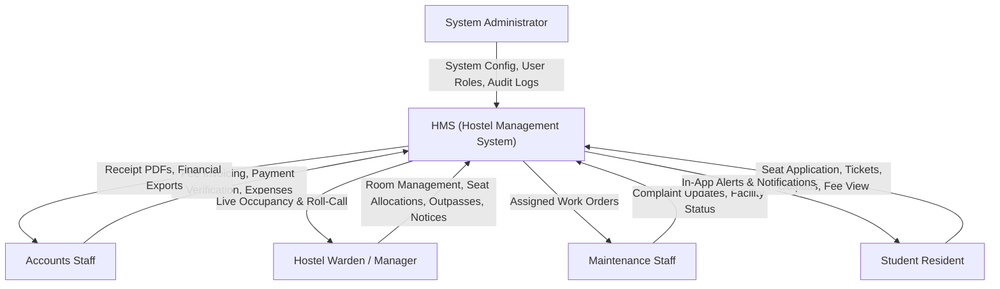

---

## 9.2 Use Case Diagram

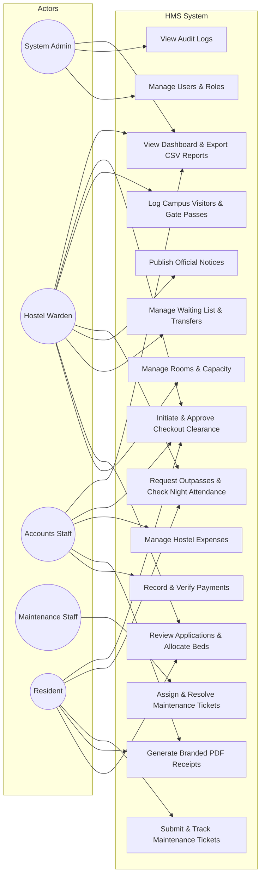

---

## 9.3 Data Flow Diagrams (DFDs)

### DFD Level 0 (Context Level)
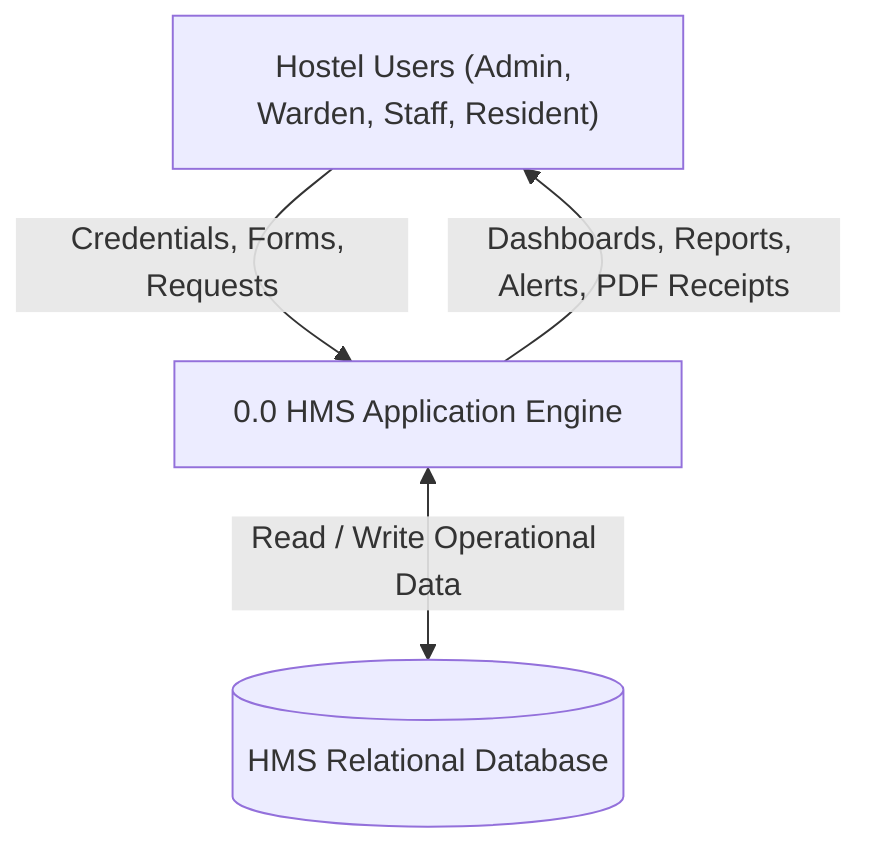

### DFD Level 1 (Major Subsystems)
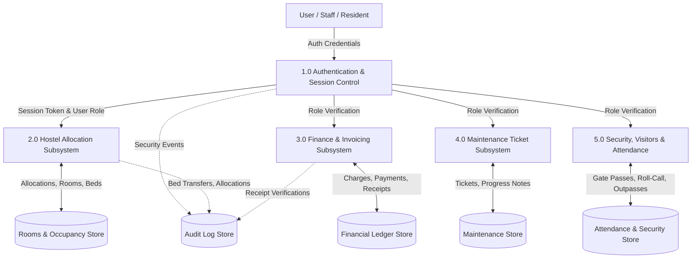

---

## 9.4 Entity-Relationship Diagram (ERD)

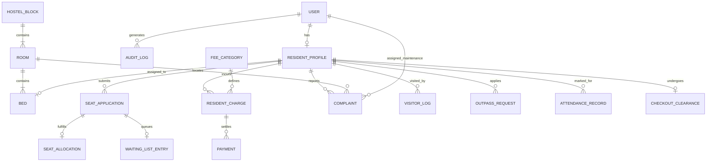

---

## 9.5 Sequence Diagrams

### 1. User Authentication
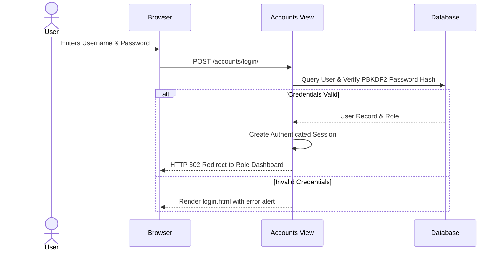

### 2. Seat Application & Approval
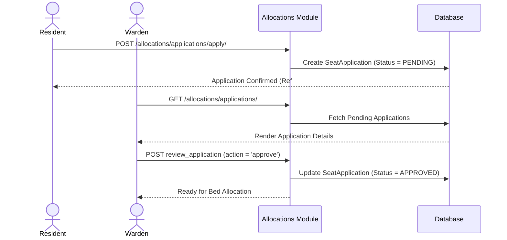

### 3. Bed Allocation (Atomic Transaction)
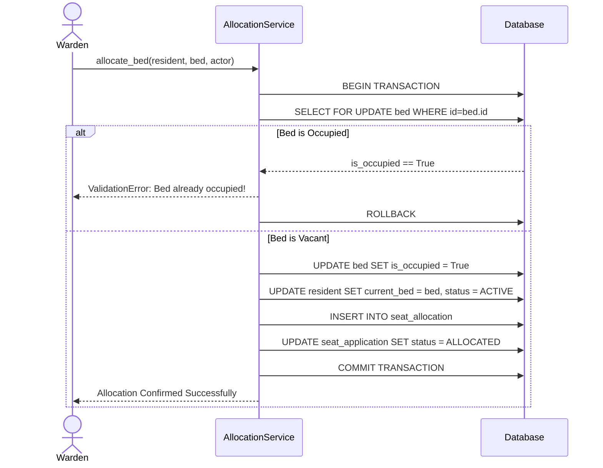

### 4. Payment Recording & Verification
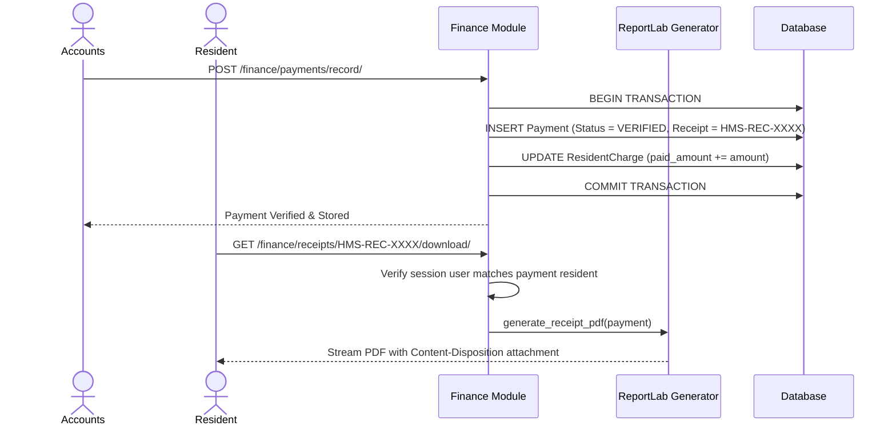

### 5. Complaint Submission & Resolution
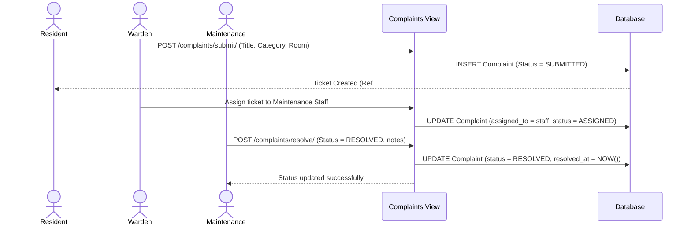

### 6. Room Transfer Workflow
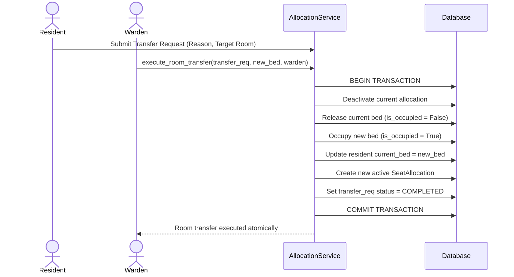

### 7. Checkout & Clearance Workflow
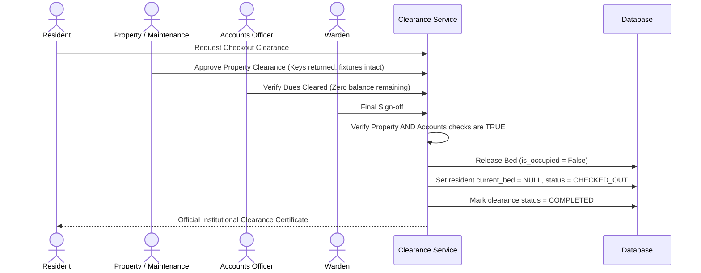

---

## 9.6 State Transition Diagrams

### Seat Application Lifecycle
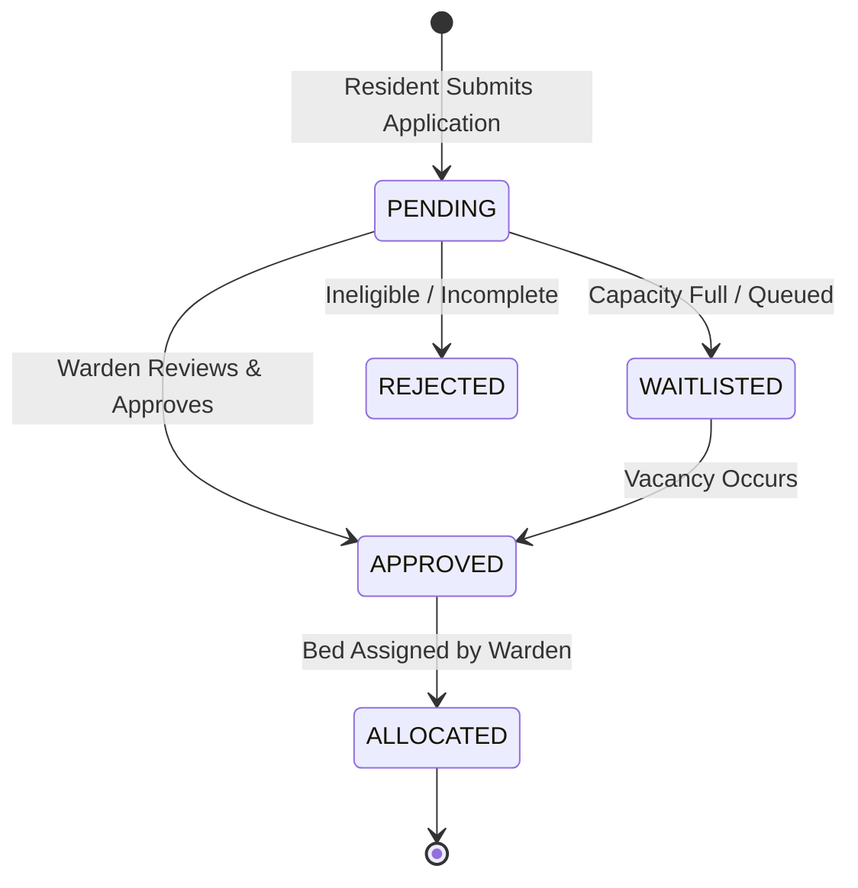

### Complaint Lifecycle
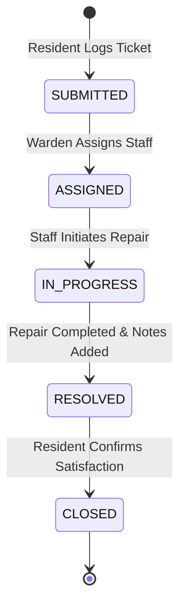

---

## 9.7 Deployment Topology

```mermaid
graph TD
    Client["Client Web Browser (Desktop / Mobile)"] -->|HTTPS (Port 443)| WebServer["Reverse Proxy (Nginx)"]
    WebServer -->|Static / Media Files| StaticStore["Static Directory (/staticfiles, /media)"]
    WebServer -->|WSGI Proxy (Port 8000)| DjangoApp["Gunicorn / Django Application Server"]
    DjangoApp -->|Database Connection| PostgresDB[(PostgreSQL / SQLite Database)]
```
